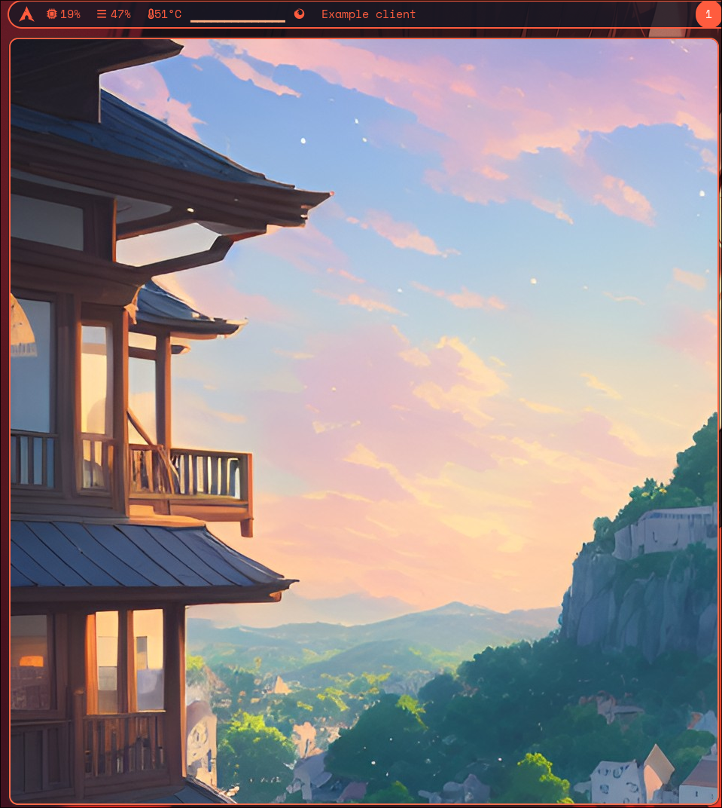
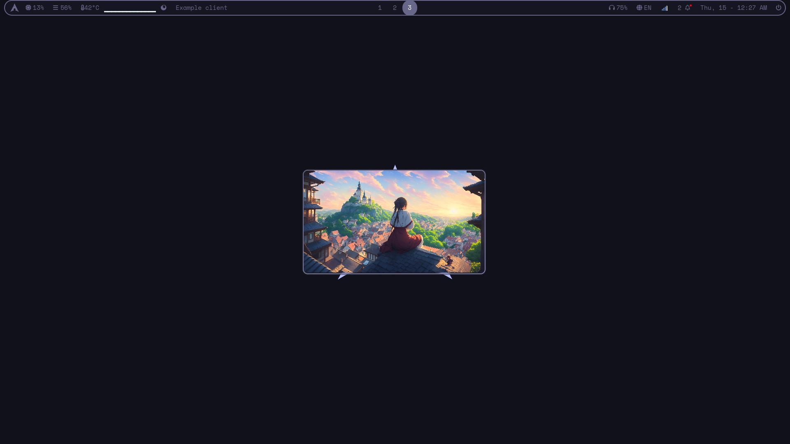
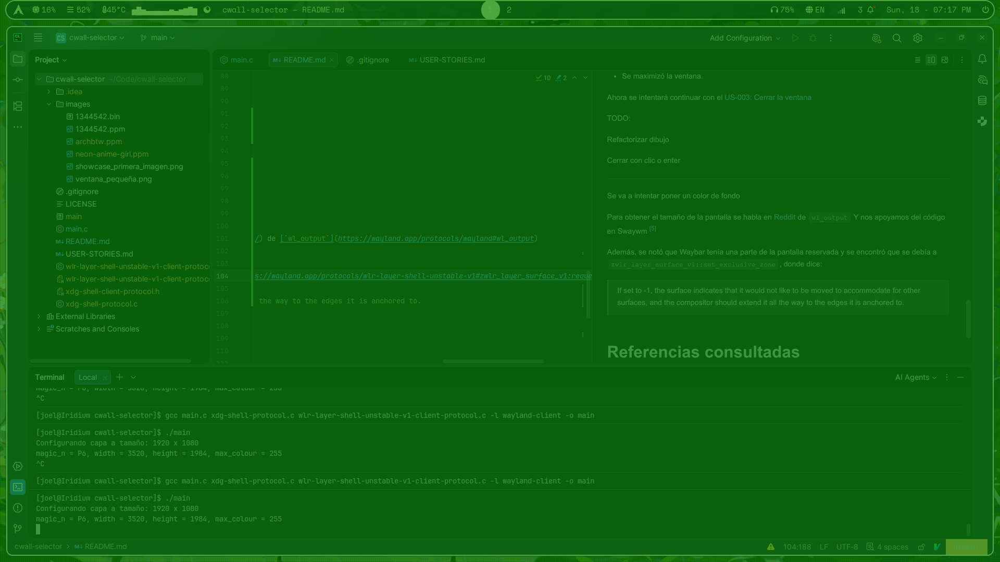

Se intentó seguir el tutorial Writing Wayland Clients[^tuto], pero usaba wl_shell y no funcionaba

Y viendo la documentación en The Wayland Protocol [^protocol], se notó que [`wl_shell`](https://wayland.freedesktop.org/docs/html/apa.html#protocol-spec-wl_shell) 
está obsoleto y sustituido por `xdg_shell`

En Wayland Explorer, se encontró información sobre [`xdg_shell`](https://wayland.app/protocols/xdg-shell)

Del video de YouTube tomado como referencia [^main_video] usamos:
```
wayland-scanner private-code /usr/share/wayland-protocols/stable/xdg-shell/xdg-shell.xml xdg-shell-protocol.c
wayland-scanner client-header /usr/share/wayland-protocols/stable/xdg-shell/xdg-shell.xml xdg-shell-client-protocol.h
gcc main.c xdg-shell-protocol.c -l wayland-client -o main
```

Al final, se notó que en video se estaban usando muchas instrucciones que se salían un poco
de lo primordial, por lo cual en el Wayland Book [^book], revisamos la sección de [XDG shell basics](https://wayland-book.com/xdg-shell-basics.html)
y se tomó el ejemplo de código de la sección [Extended example code](https://wayland-book.com/xdg-shell-basics/example-code.html)
como base. Este crea una ventana con un patrón de tablero.

Importante notar que luego, en Extended example code se dieron los comandos usados en el video, pero un poco diferentes
```
wayland-scanner private-code \
  < /usr/share/wayland-protocols/stable/xdg-shell/xdg-shell.xml \
  > xdg-shell-protocol.c
wayland-scanner client-header \
  < /usr/share/wayland-protocols/stable/xdg-shell/xdg-shell.xml \
  > xdg-shell-client-protocol.h
cc -o client client.c xdg-shell-protocol.c -lwayland-client -lrt
```
> [!NOTE]
> Se decidió usar los comandos del video


Revisar 

[fstat](https://linux.die.net/man/2/fstat)

[ejemplo hello wayland](https://gitlab.com/hdante/hello_wayland)

[the hello world wayland blog](https://hdante.wordpress.com/2014/07/08/the-hello-wayland-tutorial/)

Buscando como leer los colores de las imágenes para pasarlas al shm, se encontró en
StackOverflow una discusión iniciada en 2021 que resultó útil, [How to read images using C](https://stackoverflow.com/questions/69581117/how-to-read-images-using-c).

> [!NOTE]
> Se decidió usar en las versiones iniciales del proyecto el formato de imágenes .ppm

Esto ayudo a leer los valores del .ppm [Calculate average RGB value of a PPM file](https://stackoverflow.com/questions/55347596/calculate-average-rgb-value-of-a-ppm-file)

Con esto se llegó al punto de tener una ventana con una imagen. La imagen mantiene sus dimensiones en 
píxeles(3520x1984), mientras que la ventana puede cambiar de tamaño



Luego se puedo hacer que la imagen se viera pequeña 


Se logró hacer que la ventana se corra con SUPER + W usando el siguiente código en Hyprland:
```bash
hl.bind(mainMod .. " + " .. "W", hl.dsp.exec_cmd("cd ~/Code/cwall-selector && ./main"))
```
Probablemente, luego deba investigar como hacer eso más automático y generalista, para no tener que poner
la ruta en la cual se encuentra el proyecto.

---

Una ventana al mismo nivel de las demás no puede que sea la mejor opción, debe ser algo que se superponga como [swaync](https://github.com/ErikReider/SwayNotificationCenter), o [swaylock](https://github.com/swaywm/swaylock)

[read](https://wayland.freedesktop.org/docs/html/apb.html)

Se encontró [wlr layer shell](https://wayland.app/protocols/wlr-layer-shell-unstable-v1)

Se generaron los archivos con wayland-scanner
```bash
wayland-scanner client-header /usr/share/wlr-protocols/unstable/wlr-layer-shell-unstable-v1.xml wlr-layer-shell-unstable-v1-client-protocol.h
wayland-scanner private-code /usr/share/wlr-protocols/unstable/wlr-layer-shell-unstable-v1.xml wlr-layer-shell-unstable-v1-client-protocol.c
```

Y para implementarlo se encontró [Writing a Wayland compositor with wlroots: shells ](https://drewdevault.com/blog/Wayland-shells/), que contenía referencias a Swaywm [^ref_code]

---

## Se hicieron varios cambios:
- De momento no se está usando nada que tenga que ver con xdg
- Se agregó wlr-layer-shell, para agregar la ventana a la tapa de overlay, donde fue de mucha ayuda Swaywm/wlroots/
- Se maximizó la ventana.

Ahora se intentará continuar con el [US-003: Cerrar la ventana](USER-STORIES.md/#us-003-cerrar-la-ventana-al-presionar-enter-o-hacer-clic)

TODO:

Refactorizar dibujo

Cerrar con clic o enter

--- 

Se va a intentar poner un color de fondo

Para obtener el tamaño de la pantalla se habla en [Reddit](https://www.reddit.com/r/wayland/comments/1rfdaz9/how_to_query_current_screen_resolution/) de [`wl_output`](https://wayland.app/protocols/wayland#wl_output)
Y nos apoyamos del código en Swaywm [^ref_code]

Además, se notó que Waybar tenía una parte de la pantalla reservada y se encontró que se debía a [`zwlr_layer_surface_v1::set_exclusive_zone`](https://wayland.app/protocols/wlr-layer-shell-unstable-v1#zwlr_layer_surface_v1:request:set_exclusive_zone), 
donde dice:
> If set to -1, the surface indicates that it would not like to be moved to accommodate for other surfaces, and the compositor should extend it all the way to the edges it is anchored to.

Y con esto se logró mostrar el recuadro verde que cubre toda la pantalla.



Ahora se intentará mostrar una imagen sobre el fondo verde.

Pero primero, ahora sí, se continuará con el User story de cerrar la ventana.

Anteriormente, se había leído que usando [`wl_seat`](https://wayland.app/protocols/wayland#wl_seat) se manejaba el input de teclado.
Nuevamente, nos vamos a guiar con el ejemplo de Swaywm [^ref_code]. 

--- 

El [US-003: Cerrar la ventana](USER-STORIES.md/#us-003-cerrar-la-ventana-al-presionar-enter-o-hacer-clic) por el momento se va a marcar como completo
teniendo únicamente la funcionalidad de cerrar la ventana al presionar enter, no al hacer clic.
Pero para el MVP se piensa que es suficiente y con esto no es necesario agregar aún el listener a `wl_pointer` al `wl_seat`.


# Referencias consultadas

[^book]: [Wayland book](https://wayland.freedesktop.org/docs/book/)

[^protocol]: [The Wayland Protocol](https://wayland.freedesktop.org/docs/html/index.html)

[xdg_shell](https://wayland.app/protocols/xdg-shell)

[^tuto]: [Writing Wayland Clients](https://bugaevc.gitbooks.io/writing-wayland-clients/content/)

[^main_video]: [zero to window - wayland client (YouTube)](https://youtu.be/iIVIu7YRdY0?si=T4jjiITBwp_5KDXr)

[^ref_code]: [Swaywm/wlroots](https://github.com/swaywm/wlroots/blob/master/examples/layer-shell.c) 

[Criterios de aceptación: ejemplos para elaborarlos](https://www.scrummanager.com/blog/2023/03/criterios-de-aceptacion-definicion-y-ejemplos/)

[Sintaxis básica de redacción y formato](https://docs.github.com/es/get-started/writing-on-github/getting-started-with-writing-and-formatting-on-github/basic-writing-and-formatting-syntax)


